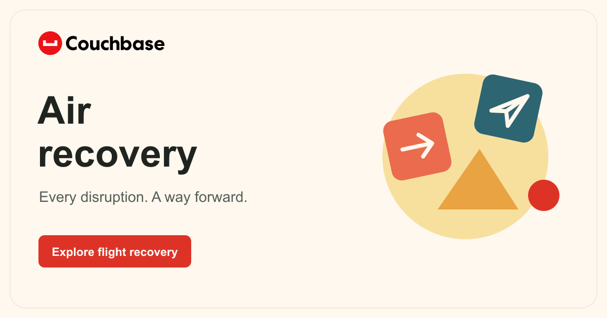

# Air Recovery

Follow a flight disruption through passenger conversations, tool calls, and recovery decisions.

[Open the demo](https://couchbase-air-simulation.vercel.app/) · [All demos](https://couchbase-demo-library.vercel.app/)

## Start here

- Trigger a storm on the dashboard.
- Open a passenger conversation and follow the response.
- Review Recovery, Cost, and **More > Commands**.
- Use **Show me around** for a short guided tour.

## What it uses

- Each visitor gets a separate run with saved requests, decisions, and usage in Capella.
- SQL AI Functions classify messages through Nova Micro, with direct Model Service fallback.
- Model Service drafts recovery proposals using the request, policy and SQL tool results.
- Agent Memory is outside this demo’s scope. SQL costs are labeled estimates; direct-model usage is measured when returned.
- Flights and passengers are fictional. The demo does not change real bookings.
- The shared allowance is 96 daily step reservations, with three concurrent model operations and 12 steps per session across resets. A direct fallback reserves an additional call.

## Run locally

Install `requirements.txt`, `uvicorn`, and the dependencies in `web/`. Keep private runtime and model configuration outside Git.

Run `python -m uvicorn air_live.http:app --port 8010`, then `npm run dev:live --prefix web`.

`npm run dev --prefix web` runs the scripted simulation instead. See [the backend audit](docs/LIVE-BACKEND-AUDIT.md) for configuration and verification. See [SQL setup](docs/sql-local-testing.md) for the SQL connection, fallback and rollback controls.

## Details and feedback

- [Technical reference and original documentation](README-REFERENCE.md)
- [Couchbase Design and UI Pattern Repair](https://github.com/john-couchbase/agent-skills)
- [Couchbase setup skill](https://github.com/john-couchbase/couchbase-aidp-setup)

When reporting an issue, include the request or input, what you expected, and a screenshot. Mention whether you used a phone, tablet, or computer.

## Simulation and live data

- Simulation is the default and runs entirely in your browser, even when the backend is off.
- Choose Live data in the header to connect to the existing isolated Couchbase run.
- Switching modes reloads the page so sample and live results stay separate. Simulation makes no backend or model calls.
